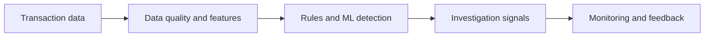
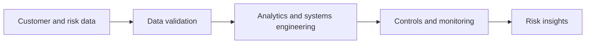

<h1 align="center">Hi 👋, I'm David Lee</h1>

<h3 align="center">AI Engineer · Data Scientist · Financial Crime & Risk Analytics</h3>

  Building practical, interpretable machine learning systems for financial services.

  
  
  
  

---

### 👨‍💻 About me

I'm an **AI Engineer and Data Scientist** working at the intersection of **machine learning, financial crime, credit risk and scalable engineering**.

My experience includes fraud and anti-money-laundering analytics, behavioural modelling, and risk engineering, including transaction-monitoring solutions operating across approximately **600 million retail transactions per month**.

I enjoy turning statistical research into reliable, explainable solutions that help teams make better decisions.

### 🔭 What I'm working on now

**Lead Data Scientist · Financial Crime | Santander (Mar 2026 – Present)**

- Building and improving **fraud and AML detection** using machine learning, anomaly detection and rule-based approaches.
- Developing **behavioural features**, supporting alert quality, model explainability and ongoing monitoring.
- Working with investigators, risk specialists and engineers to turn analytical findings into practical workflows.
- Using **Python, SQL, AWS, Airflow, MLflow, MinIO, HUE and ThetaRay** across data and model workflows.

**Illustrative workflow — financial crime analytics**

### 🕰️ What I worked on before

**Senior Credit Risk Analyst — System Engineer | Santander (Apr 2024 – Mar 2026)**

- Worked across **credit-risk analytics and systems engineering**, connecting data, technology and risk requirements.
- Supported reliable risk-data workflows, analysis and controls to make models and processes easier to operate and monitor.

**Research & earlier projects**

- **Healthcare survival analysis** — statistical and deep-learning approaches to time-to-event modelling.
- **Computer vision** — image retrieval and diabetic-retinopathy classification.
- **Forecasting** — applying machine learning to energy and time-series data.

**Illustrative workflow — credit risk and analytical engineering**

### 🧰 Languages, frameworks & tools

**Machine learning & data science**

  &nbsp;
  &nbsp;
  &nbsp;
  &nbsp;
  &nbsp;
  &nbsp;
  &nbsp;
  

**Data, cloud & MLOps**

  &nbsp;
  &nbsp;
  &nbsp;
  &nbsp;
  &nbsp;
  &nbsp;
  &nbsp;
  

**Programming & application development**

  &nbsp;
  &nbsp;
  &nbsp;
  &nbsp;
  

**Additional tools and platforms**

`SQL` · `MLflow` · `MinIO` · `HUE` · `ThetaRay` · `GitHub Actions` · `Redis` · `RabbitMQ`

### 📌 Featured project

**[Apple Live Photo Convert](https://github.com/davidlee1102/apple_live_photo_convert)** — Python utilities for restoring and organising Apple Live Photos from HEIC and MOV files on macOS.

  

<i>Always curious. Always building.</i>

